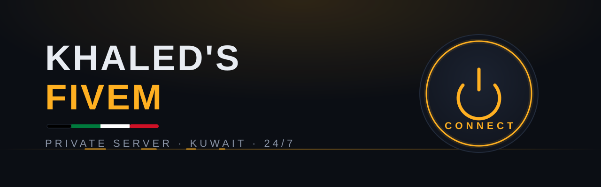

<p align="center">
  
</p>

<p align="center">
  <a href="https://fivem-connect-production.up.railway.app"></a>
  
  
  
</p>

# Khaled's FiveM

Private GTA V multiplayer server (FiveM / FXServer) for me and my friends, self-hosted on a Linux VPS with fully automated operation — it starts itself, heals itself, and never needs babysitting.

**Join:** open the [connect page](https://fivem-connect-production.up.railway.app) and press the button, or in FiveM press <kbd>F8</kbd> and type:

```
connect 72.60.89.132:30120
```

## How it runs 24/7

Three independent layers keep the server alive:

| Layer | What it does | When |
|---|---|---|
| Supervisor loop | restarts the server 5s after any crash | instant |
| `@reboot` cron | starts the server when the machine boots | on boot |
| Watchdog cron | revives the server if anything else killed it | every 5 min |

The server runs inside a `tmux` session named `fivem`, so there is always a live console to attach to.

## The `fivem` CLI

Everything is controlled with one command (installed to `~/.local/bin/fivem`, source in [`bin/fivem`](bin/fivem)):

```
fivem key <key>    save your Cfx.re license key
fivem start        start server (tmux + auto-restart supervisor)
fivem stop         stop server
fivem restart      restart server
fivem status       running state + connect addresses
fivem console      attach to live server console (Ctrl-b d to detach)
fivem cmd <text>   send a console command (e.g. fivem cmd say hello)
fivem log [n]      show last n log lines
```

## Setup on a fresh machine

```bash
git clone https://github.com/khaledq84ever/fivem-server.git ~/fivem
cd ~/fivem && bash setup.sh
fivem key cfxk_xxxx   # free key from https://portal.cfx.re/servers/registration-keys
fivem start
```

`setup.sh` downloads the latest FXServer build, pulls the base [cfx-server-data](https://github.com/citizenfx/cfx-server-data) resources, installs the CLI, and registers both crons. Big binaries and the license key are never committed — see [`.gitignore`](.gitignore).

## Layout

```
fivem/
├── assets/        banner + icon (SVG)
├── bin/fivem      control CLI
├── server/        FXServer build        (downloaded, not in git)
├── server-data/
│   ├── resources/ base resources        (cloned, not in git)
│   └── server.cfg server configuration
├── setup.sh       one-shot restore script
└── license.key    Cfx.re key            (secret, not in git)
```

## Related

- **[fivem-connect](https://github.com/khaledq84ever/fivem-connect)** — the live status + one-click connect page, deployed on Railway.

---

<p align="center"><br><sub>Private server · Kuwait · not affiliated with Cfx.re or Rockstar Games</sub></p>
