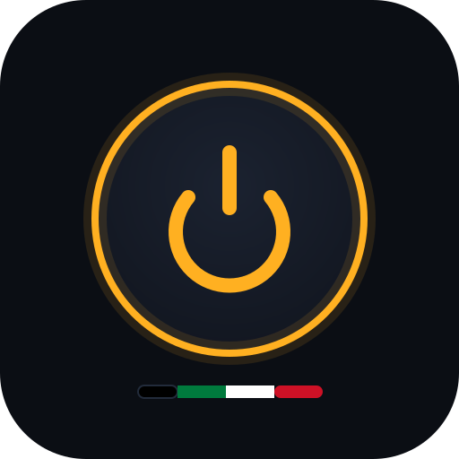

<p align="center">
  
</p>

<h1 align="center">fivem-connect</h1>

<p align="center">
  Live status + one-click connect page for <a href="../README.md">Khaled's FiveM server</a>.<br>
  <b>Live:</b> <a href="https://fivem-connect-production.up.railway.app">fivem-connect-production.up.railway.app</a>
</p>

## What it does

- Shows the server's **live status** — online/offline, players, mode, map (polls every 10s)
- One big **CONNECT** button that opens FiveM and joins the server via a `fivem://connect/ip:port` deep link
- Copyable F8 command as fallback, plus a 3-step guide for friends new to FiveM

## How it works

Zero dependencies — one Node file:

- `server.js` — serves the page and proxies `/api/status` → the game server's `dynamic.json` (the browser can't query the game server directly because it sends no CORS headers)
- `index.html` — the whole UI, single file (Big Shoulders Display + Inter + JetBrains Mono)

## Run locally

```bash
node server.js   # http://localhost:3000
```

## Deploy

Hosted on Railway (project `fivem-connect`):

```bash
railway up --detach --service fivem-connect
```
